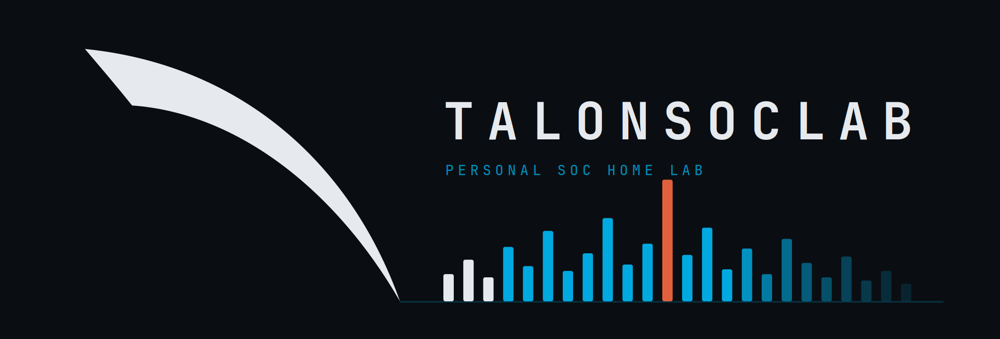

## Status

| Phase | Deliverable | |
|---|---|:---:|
| **A — Foundation SOC Stack** | Wazuh + Sysmon + Suricata, real-device agents, custom dashboards |  |
| **A+ — Hardening** | Host timers with failure alerts, log retention, secrets out of argv, credential rotation, encrypted Tier 2 backups |  |
| **B — Detection Engineering** | Sigma rule pack validated against MITRE ATT&CK | 🚧 |
| **C — AD Attack & Defense** | Mini-AD, top-5 detection chain, purple-team report | ⏭ |
| **D — Honeynet + Threat Intel** | T-Pot into OpenCTI with threat-intel enrichment | 🔴 |

 complete &nbsp;·&nbsp; 🚧 in progress &nbsp;·&nbsp; ⏭ next &nbsp;·&nbsp; 🔴 not started

Phase A closed on 2026-10-25 with the stack hardened: host timers with failure alerts, 14-day log retention, no secret in any process's arguments, credentials rotated, and age-encrypted backups the SIEM itself watches. Phase B is detection engineering. The noise baseline is measured first, so every rule that follows is judged against what the lab actually looks like when nothing is happening. Then a Sigma rule pack, each rule converted to Wazuh, mapped to MITRE ATT&CK and proven with a positive control on the live manager.

## Why

This is my first home lab. I learn by building the thing instead of reading about it, so I'm standing up a small SOC end to end and keeping it public for anyone coming up behind me.

## Follow along

 Project page: <https://ktalons.github.io/projects/talonsoclab/> 
 Blog posts as each phase ships: <https://ktalons.github.io/blog/> 
 CASA (reasoning layer): <https://github.com/ktalons/casa-ai-agent> 
 Main site: <https://ktalons.github.io/> 
 LinkedIn: <https://www.linkedin.com/in/ta1ons/>
